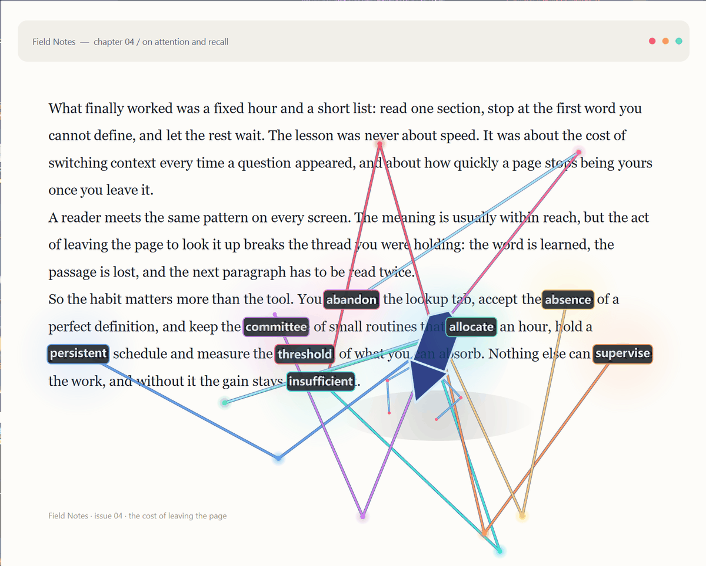
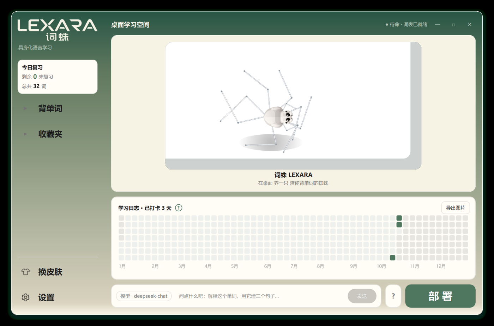
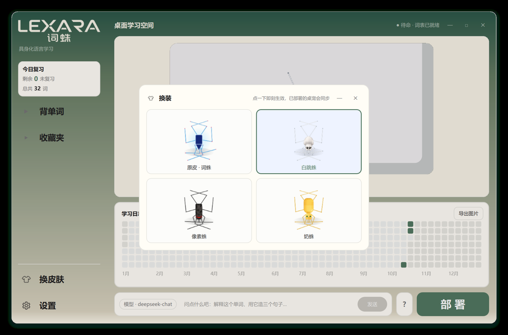
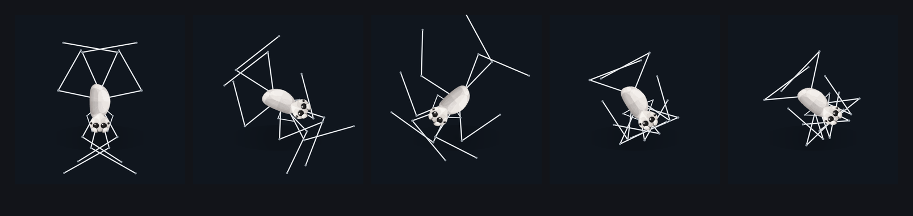
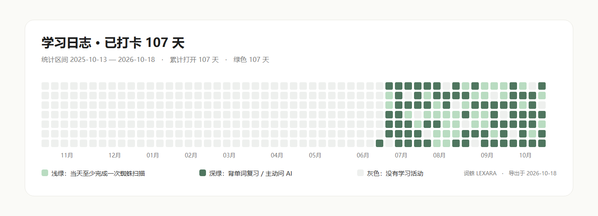

<div align="right"><a href="README.md">简体中文</a>\&nbsp;·\&nbsp;<b>English</b></div>

# LEXARA · 词蛛

### A desktop spider that learns words with its eight legs

> Click its head → lasso a paragraph of English on your screen → the spider crawls onto the text and  
> **pins eight words, one per leg**, with phonetics, Chinese definitions and exam-syllabus tags →  
> one click to save them, then spaced review at 1 / 3 / 7 / 14 days.




<p align="center"><sub>Real screenshot from the running app: after lassoing a paragraph, the spider lies over the text and each of its eight legs reaches for one unfamiliar word. Word-box colour = the colour of the leg that reached it.</sub></p>

**Fully offline.** Screenshots, OCR, dictionary lookups and review scheduling all happen on your machine — no uploads, no account, no bundled API keys.

**The spider is computed, not animated.** Eight walking legs plus two antennae, two-bone IK, threshold-driven gait, solved every frame. No sprite sheet, no skeletal animation files.

---

## Contents

|                                            |                                   |
| ------------------------------------------ | --------------------------------- |
| [What it is](#what-it-is)                  | [Features](#features)             |
| [Screenshots](#screenshots)                | [Install](#install)               |
| [How to use](#how-to-use)                  | [Data & privacy](#data--privacy)  |
| [How it works](#how-it-works)              | [Project layout](#project-layout) |
| [Development & tests](#development--tests) | [Known limits](#known-limits)     |
| [License & credits](#license--credits)     |                                   |

---

## What it is

Most vocabulary tools make you **leave what you are reading**: switch to an app, screenshot it, paste it, wait. When you come back you have lost your place.

LEXARA collapses that into "never leave the screen". The spider sits on your desktop. The moment you hit a word you don't know, you click its head and lasso it — the spider crawls over and pins the words down. Recognition, lookup, tagging and scheduling all happen in that single gesture.

It is two things at once:

- **A desktop pet** — transparent, always-on-top, click-through outside its body, walks and hops, four skins, gets out of your way;
- **A word scanner** — lasso to recognise, offline OCR + a 758k-entry dictionary + eight exam syllabi, with eight legs nailing the result onto the original text.

One full scan:

```
Click the spider's head  →  screen freezes and dims, drag a box over some English  →  release
      ↓
Offline OCR (RapidOCR, pure ONNX, keeps word-level coordinates)
      ↓
Word selection: skip function words (the / of / because) → lemmatise → syllabus first → out-of-list fallback
      ↓
The spider walks under the word cluster and reaches one leg per word (a guide line for anything out of reach)
      ↓
Result card: phonetics / definition / syllabus tag / save ★  →  wordbook, scheduled at 1·3·7·14 days
```

---

## Features

### Scanning

| Feature                   | Detail                                                                                                                                                                                           |
| ------------------------- | ------------------------------------------------------------------------------------------------------------------------------------------------------------------------------------------------ |
| Lasso to scan             | Freezes the screen, drag a box; Esc / right-click cancels; minimum-area guard                                                                                                                    |
| Offline OCR               | RapidOCR (pure ONNX Runtime, models shipped in-repo), mixed Chinese/English, keeps line coordinates and maps them to word boxes                                                                  |
| Multi-monitor & DPI       | Stitched capture, physical/logical pixel conversion; word boxes stay aligned at 150% scaling                                                                                                     |
| Eight legs on eight words | Full-screen transparent overlay, **minimum-cost assignment** between 8 legs and 8 words; words out of reach only get a guide line instead of a stretched ray                                     |
| Colour mapping            | Each word box takes the colour of the leg that reached it, so the pairing is obvious                                                                                                             |
| Stays on screen           | It does not fade away on its own — a click on the spider dismisses it (global low-level mouse hook). The overlay is click-through, so other windows stay usable meanwhile                        |
| Function-word filter      | the / of / because and friends are skipped; can be turned off                                                                                                                                    |
| Eight syllabi             | CET-4 / CET-6 / Postgraduate / IELTS / TOEFL / GRE / Industrial English / All; in-syllabus words come first, others are tagged "off-list"                                                        |
| Lemmatisation             | Plurals, tenses and comparatives are reduced to the base form before lookup                                                                                                                      |
| Confidence floor          | 0–100% adjustable; low-confidence OCR words never make it to the overlay                                                                                                                         |
| Skip what you know        | Words at stage ≥3 with more right than wrong answers stop bothering you                                                                                                                          |
| Optional AI context       | One button per word, only fires when clicked: sense-in-context, collocations, example sentences. **Screenshots are never sent** — only the word, dictionary senses and the neighbouring sentence |

### Desktop pet

| Feature                | Detail                                                                                                                                                              |
| ---------------------- | ------------------------------------------------------------------------------------------------------------------------------------------------------------------- |
| Procedural spider      | 8 walking legs + 2 antennae, two-bone IK (hip → knee → tip), rectangular cephalothorax + three-point body chain                                                     |
| Threshold gait         | Feet stay planted; a leg steps only when its rest position drifts past 30% of leg length; at most 4–6 legs move at once; a stepping foot lifts 18% toward the hip   |
| No random jitter       | Footfall = rest position + velocity look-ahead. Jitter makes feet wander in place and the stance dissolves                                                          |
| Four skins             | Original / **White jumping spider (default)** / Pixel / Milk, applied instantly                                                                                     |
| Skins change body only | Leg length, leg roots, hit areas, gait and window size are identical across all four; switching never rebuilds the spider, so a mid-walk skin change doesn't twitch |
| Deformation            | Jump arc (crouch → launch → air → landing bounce), head-pat, squash, shake, dash                                                                                    |
| Click-through          | Everything outside the legs and body ignores mouse events                                                                                                           |
| Right-click menu       | Scan / wordbook / skins / scan settings / back to launcher / quit                                                                                                   |

### Learning

| Feature           | Detail                                                                                                                                                                          |
| ----------------- | ------------------------------------------------------------------------------------------------------------------------------------------------------------------------------- |
| Wordbook          | Search, delete, clear, save-all; five syllabus groups (CET-4 / CET-6 / IELTS / TOEFL / Industrial) plus an "uncategorised" fallback                                             |
| Spaced repetition | 1 → 3 → 7 → 14 days; correct answers advance, wrong ones drop back to tomorrow, due words first                                                                                 |
| Review flow       | Recall → reveal → self-grade (known / unknown) → progress → summary → retry only the missed words                                                                               |
| Study calendar    | 53×7 heatmap with day / week / month / year views; **days opened and days studied are counted separately**; three shades (grey / light green = scanned / dark green = reviewed) |
| Achievements      | 7 / 30 / 100-day milestones plus an all-green achievement, persisted once, re-shown after a crash if missed                                                                     |
| Export an image   | The achievement card exports to a calendar-only PNG you can post anywhere                                                                                                       |

### Launcher & system integration

- **Launcher** — frameless rounded card, custom title bar, 8-direction edge resize; left nav (today's review / favourites / review / skins / settings), right side a glass jar with the spider waiting inside
- **Deploy / recall timeline** — "Deploy" cracks the jar in three stages, flashes the web, shatters it and the spider crawls out onto your desktop; "Back to launcher" sucks it into the jar again
- **Skin panel** — four thumbnails, click to apply, the deployed pet updates live
- **Settings** — max words per scan / confidence floor / pet size / always-on-top / definition card / restore defaults
- **Start on boot** — writes a shortcut into the current user's Startup folder, idempotent, no admin rights, rolls back and explains if it fails
- **Auto-deploy on launch** — an independent switch from start-on-boot, fires once per process
- **Crash log** — faulthandler + custom excepthook → `run.log`
- **Optional AI chat** — input box at the bottom of the launcher, OpenAI-compatible endpoint, cancellable background worker; the key is encrypted with Windows DPAPI

---

## Screenshots

Launcher — today's review and navigation on the left, the spider waiting inside the jar, "Deploy" at the bottom.



Skin panel — four skins, click to apply, the desktop pet follows immediately.



The gait is solved from geometry every frame. These five frames are real renders of the same engine at idle, walking and jumping — not an animation asset:



Achievement export — calendar heatmap plus milestones, exported as a calendar-only PNG. (Real data from the author's machine: 107 days.)



---

## Install

Two routes. **Neither needs an account or online activation.**

|          | Route A · prebuilt exe                                                   | Route B · from source                           |
| -------- | ------------------------------------------------------------------------ | ----------------------------------------------- |
| For      | Just want to use it                                                      | Want to read/modify code, or avoid a random exe |
| Requires | nothing                                                                  | Python 3.13 x64                                 |
| Size     | ~150 MB single file                                                      | ~300 MB of dependencies on first install        |
| Startup  | 10–20 s the first time (unpacks the bundled dictionary), fast afterwards | slightly faster                                 |
| Updates  | download a new exe                                                       | `git pull`                                      |

### Route A · the prebuilt exe

1. Download `Lexara.exe` from [Releases](../../releases).
2. Double-click it. **No Python, no runtime installs.**
3. Windows may show "Windows protected your PC" — the binary is not code-signed (an EV certificate costs a few hundred dollars a year for a personal project). Click **More info → Run anyway**; the prompt won't return.
4. The first launch unpacks its internals (including the 758k-entry dictionary) to a temp folder — about 10–20 seconds. Later launches are quick.
5. When the launcher opens, click **Deploy** in the bottom-right corner and the spider drops onto your desktop.

> The exe is not in the repository — a 150 MB single file has no business in Git history, so it ships as a Release asset only. What you clone here is pure source.

- Requires **Windows 10 / 11, 64-bit** only (see [Known limits](#known-limits) for why)
- No admin rights, no registry writes, no background service, no scheduled task
- Uninstall: delete the exe, then delete `%APPDATA%\Lexara`

> Antivirus products occasionally flag it. A PyInstaller one-file exe self-extracts, which looks a lot like a packer — a common false positive. If that bothers you, use Route B and run from source.


### Route B · build from source

**Prerequisite:** Python **3.13** (64-bit). Tick `Add python.exe to PATH` during installation. Earlier versions are untested.

```bash
git clone https://github.com/<your-name>/lexara.git
cd lexara
```

**Step 1 — environment and dependencies (one click)**

Double-click `install_first.bat`. It locates Python, creates `.venv`, upgrades pip, then installs `requirements-runtime.txt`. Re-running it is safe (an existing `.venv` is reused).

**Step 2 — run**

Double-click `run.bat`. It finds `.venv` automatically (falling back to a system interpreter) and starts `src/main.py`.

With arguments (e.g. self-test with frame-by-frame screenshots):

```bat
run.bat --selftest
```

**Step 3 — deploy**

Click **Deploy** in the launcher.

#### Manual install (no .bat, or inside an IDE)

```bat
py -3.13 -m venv .venv
.venv\Scripts\python -m pip install -U pip
.venv\Scripts\python -m pip install -r requirements.txt
.venv\Scripts\python src\main.py
```

`requirements.txt` is `requirements-runtime.txt` plus PyInstaller (only needed for packaging):

```
PySide6-Essentials == 6.12.0      # Qt 6 + QtQuick (Addons not required)
shiboken6          == 6.12.0
rapidocr_onnxruntime == 1.2.3     # offline OCR
onnxruntime        == 1.31.0
opencv-python      == 5.0.0.93
numpy              == 2.5.4
pyinstaller        == 6.22.3      # packaging only
```

#### Slow downloads

Switch to a mirror (if `.venv` already exists, this one line is enough):

```bat
.venv\Scripts\python -m pip install -r requirements-runtime.txt ^
    -i https://pypi.tuna.tsinghua.edu.cn/simple
```

#### Troubleshooting

| Symptom                        | Cause and fix                                                                                                          |
| ------------------------------ | ---------------------------------------------------------------------------------------------------------------------- |
| `No Python interpreter found`  | Python isn't on PATH. Reinstall with `Add python.exe to PATH`, or call `py -3.13` explicitly                           |
| pip hangs / times out          | PyPI is slow from some networks. Use the mirror above; behind a corporate proxy set `HTTP_PROXY` / `HTTPS_PROXY` first |
| `opencv-python` won't install  | Usually the wrong Python version or architecture (needs 64-bit 3.13), or no wheel for the platform                     |
| `run.bat` flashes and exits    | Run it from a terminal to see the error, then check the last lines of `%APPDATA%\Lexara\run.log`                       |
| UI opens but no spider         | Click **Deploy**; or right-click the tray icon → show pet                                                              |
| The spider ended up off-screen | Reset position from the right-click menu, or delete `%APPDATA%\Lexara\settings.json` and restart                       |

> Both `.bat` files must stay **pure ASCII**. `cmd` decodes the whole script with the OEM code page first, so any non-ASCII byte breaks every line — a trap this project already fell into, which is why the Chinese instructions live in the README instead.

#### Optional: bring your own model

Core features **never need a network or a key**. Only the launcher's chat box and "AI context" need an OpenAI-compatible endpoint you supply.

**Option 1 — in the UI**

Launcher → Settings → **Configure** next to the model field → Base URL / model name / key → Save. The key is encrypted with **Windows DPAPI** into `%APPDATA%\Lexara\ai_secret.bin`; only your Windows account can decrypt it.

**Option 2 — environment variables**

```bat
setx LEXARA_AI_API_KEY "sk-..."
setx LEXARA_AI_URL     "https://api.openai.com/v1"
setx LEXARA_AI_MODEL   "gpt-4o-mini"
```

Reopen the terminal and the app. Precedence: **UI value > environment variable**. A Base URL is auto-completed with `/chat/completions`; a full endpoint also works. `http://localhost:<port>` is allowed for local models; plain-HTTP public hosts are rejected.

#### Optional: build your own exe

```bat
.venv\Scripts\python -m pip install -r requirements.txt
.venv\Scripts\python -m PyInstaller Lexara.spec
```

Output lands in `dist\Lexara.exe`. Or double-click `tools\build_exe.bat`, which **runs the full test suite before packaging** and refuses to build on failure.

Five `.spec` files ship in the repo: `Lexara` (release), `LexaraDebug` (console), `LexaraFixed`, `LexaraPortable`, `LexaraPortableDebug`. They share one structure; only `name`, `console` and `onefile` differ.

---

## How to use

| Action                                            | Effect                                                                                                             |
| ------------------------------------------------- | ------------------------------------------------------------------------------------------------------------------ |
| **Click the spider's head** (the rectangular end) | Start a lasso scan                                                                                                 |
| **Ctrl + Shift + S**                              | Quick lasso (no need to find the spider first)                                                                     |
| **Double-click**                                  | Same as above                                                                                                      |
| **Drag**                                          | Move the spider (eight legs scurry with the threshold gait)                                                        |
| **Click the body**                                | Random reaction: jump / squash / shake / dash                                                                      |
| **Scroll wheel**                                  | Scale up / down (persisted)                                                                                        |
| **Right-click**                                   | Menu                                                                                                               |
| **After a scan**                                  | Click the spider's head or body to dismiss the overlay; click a word box or the result card for details and saving |

Only clicking the spider's head or body dismisses the overlay; clicking elsewhere neither dismisses it nor swallows the event (the overlay is click-through), so you can keep working in other windows.

Function words are skipped and in-syllabus words come first. Hit ★ on the result card, or "save all". Saved words enter the wordbook and get scheduled at 1 / 3 / 7 / 14 days.

In the heatmap: grey = no activity, light green = at least one scan that day, dark green = reviewed words or deliberate AI use.

---

## Data & privacy

| Item          | Location                          | Notes                                                                                       |
| ------------- | --------------------------------- | ------------------------------------------------------------------------------------------- |
| Dictionary    | bundled `assets/ecdict.sqlite`    | ECDICT Revised v0.1.1, **758,497** entries, read-only                                       |
| Syllabus tags | bundled `assets/exam-tags.sqlite` | 14,942 words, decoupled from the dictionary                                                 |
| Settings      | `%APPDATA%\Lexara\settings.json`  | skins, syllabus, word count, confidence…                                                    |
| Wordbook      | `%APPDATA%\Lexara\wordbook.json`  | saves + review progress; **atomic writes**, crash-safe, older schemas still readable        |
| Theme         | `%APPDATA%\Lexara\theme.json`     |                                                                                             |
| Log           | `%APPDATA%\Lexara\run.log`        | first place to look when something breaks                                                   |
| AI key        | `%APPDATA%\Lexara\ai_secret.bin`  | only exists once you configure it; DPAPI-encrypted, unreadable from another Windows account |

- **Screenshots never leave the machine.** The lasso captures the local screen, OCR runs on a local ONNX model, and the temporary image is not written to disk.
- **No account, no cloud sync, no telemetry.** There is no reporting endpoint anywhere in the codebase.
- Backing up your wordbook = copy `wordbook.json`. Factory reset = delete the whole `%APPDATA%\Lexara` folder.

---

## How it works

### Two-stage interaction

```
Launcher (QML)  ──"Deploy"──▶  Pet (Qt Widgets)  ──lasso──▶  Aim overlay
      ▲                              │
      └────────"back to launcher"────┘
```

The launcher is where the spider is kept; the pet is the spider at work. Two windows in one process, sharing one `settings.json`.

### Stack

| Layer         | Choice                                  | Why                                                                                            |
| ------------- | --------------------------------------- | ---------------------------------------------------------------------------------------------- |
| Language      | Python 3.13                             | all business logic                                                                             |
| GUI           | PySide6 6.12 (Qt 6)                     | both Qt Widgets and Qt Quick/QML in use                                                        |
| Rendering     | `QPainter`, frame by frame              | spider, jar cracks, heatmap and word boxes are all drawn in code — no image-sequence animation |
| Launcher      | QML + Python bridge                     | `src/qml/Main.qml` + `src/launcher_qml.py`                                                     |
| Pet / overlay | Qt Widgets (custom paint + region mask) | fully transparent, always-on-top, click-through; Widgets is steadier than QML here             |
| OCR           | RapidOCR 1.2.3 (pure ONNX)              | offline, bilingual, models bundled, coordinates preserved                                      |
| Dictionary    | SQLite (full ECDICT)                    | read-only connections via `threading.local`, never blocks the UI                               |
| Packaging     | PyInstaller 6.22                        | one-file exe with Qt and OCR models inside                                                     |

Deliberately **no web stack**: the pet needs transparency, always-on-top, region click-through and 60 fps custom painting. `QPainter` is far cheaper than wrapping a WebView, and `QtWebEngine` is explicitly excluded at packaging time.

### Details worth knowing

<details>

<summary><b>The gait was ported, not invented</b></summary>

`STEP_FRAC=.3 / URGENT_FRAC=.5 / OVER_FRAC=.92 / PLACE_FRAC=.85`,  
`LEAD_SECONDS=.3 / LEAD_MAX_FRAC=.3`, step duration 0.10–0.17 s, 18% foot lift —  
all aligned with the `T` object of `crawler.js`.

Footfall targets are "rest position + velocity look-ahead" with **no random jitter** — jitter makes feet wander in place and the stance collapses into a clump.

</details>

<details>

<summary><b>Body displacement must be fed to the gait engine</b></summary>

Feet are planted, so moving the body shifts every rest position relative to its foot; a leg steps once that offset crosses the threshold. The pet passes the body-centre displacement each frame into `Spider.update(..., motion=...)`. Without it, the legs simply never move.

</details>

<details>

<summary><b>The window mask follows live leg positions</b></summary>

Building the mask from the rest pose clips legs that are mid-step — they vanish and only the foot dots remain. The mask is therefore rebuilt from current hip / knee / tip positions at ~12 Hz.

</details>

<details>

<summary><b>OCR coordinates don't get doubled</b></summary>

Scaling a small image and then multiplying coordinates by the zoom factor shifts every word box by exactly one factor. `test/test_ocr_coords.py` guards that regression: coordinates are computed in the original image space, and scaling happens only at paint time.

</details>

### Scale

- **33 Python modules + 1 QML file**, about **25,700 lines**
- 758,497 dictionary entries, 14,942 syllabus-tagged words, eight filter presets
- ~150 MB single-file exe (Qt + OCR models + dictionary); first launch unpacks in 10–20 s
- The OCR model (~90 MB resident) is unloaded after 8 idle minutes and rebuilt on the next scan

---

## Project layout

```
lexara/
├── src/
│   ├── main.py                 entry point (--selftest / --ocr-test)
│   ├── crawler_spider.py       procedural spider: geometry + two-bone IK + threshold gait + leg↔word assignment
│   ├── spider_painter.py       QPainter rendering
│   ├── aim_overlay.py          full-screen aim overlay for the eight-leg landing
│   ├── capture.py              frozen-desktop capture + lasso (multi-monitor, DPI conversion)
│   ├── ocr_engine.py           RapidOCR wrapper, keeps word-level coordinates
│   ├── ocr_registry.py         engine registry with real availability probes
│   ├── lexicon.py              full ECDICT lookup + syllabus tags + word selection
│   ├── wordbook.py             saves + spaced-repetition scheduling
│   ├── review_session.py       review session shared by QML and Widgets
│   ├── activity.py             calendar events and statistics
│   ├── calendar_export.py      achievement PNG export
│   ├── pet_window.py           pet window (state machine / interaction / tray)
│   ├── launcher_qml.py         launcher QML ↔ Python bridge
│   ├── dialogs.py              result card / wordbook / settings
│   ├── settings_store.py       atomic settings persistence
│   └── qml/Main.qml            launcher UI
├── test/                       unit tests
├── tools/                      screenshots, render diagnostics, packaging, probes
├── assets/                     dictionary, syllabus tags, skins, icons, sfx
├── docs/screenshots/           images used by this README
├── install_first.bat           creates .venv and installs dependencies
├── run.bat                     starts the app
└── *.spec                      five PyInstaller configs
```


## Known limits

"Looks clickable" is not "finished". These are stated plainly.

**Working, test-covered**

- Lasso → OCR → word selection → eight-leg landing → result card → save → spaced review, end to end
- All pet interactions (drag / scale / reactions / context menu / click-through)
- Four skins applied live, synced both ways between launcher and pet
- Full deploy / recall timeline in the launcher
- Persisted settings, start-on-boot, auto-deploy once per launch
- Study calendar with achievement export, syllabus-grouped favourites
- QML review flow (writes real 1/3/7/14 scheduling)
- One-file exe packaging and cold start

**Deliberately not built**

- Multi-user / cloud sync / accounts (strictly local, single machine)
- Mobile, macOS, Linux — relies on Windows-only APIs: `WH_MOUSE_LL` global mouse hook, DPI conversion, DPAPI key encryption, the Startup folder. Other platforms need a different secure-storage design
- Continuous "spider sense" auto-scanning (the help panel says "planned", and the UI never claims otherwise)
- Spelling / listening question types; the review flow is recall + self-grade only
- AI chat is **non-streaming**; the UI shows an honest "requesting" state instead of faking typing

**Verification scope**

- High DPI: the development machine is a single 150%-scaled display and every screenshot and probe passed there; 100% / 125% were checked with `QT_SCALE_FACTOR`, but **real 100%/125% hardware and multi-monitor negative coordinates are untested**

---

## License & credits

**The program code and hand-drawn assets are [MIT licensed](LICENSE).**

Third-party projects and data (full inventory with versions and licence texts in [`THIRD_PARTY_NOTICES.md`](THIRD_PARTY_NOTICES.md) and `licenses/`):

| Project                                                                                                                                    | Use                                                                                                 | License            |
| ------------------------------------------------------------------------------------------------------------------------------------------ | --------------------------------------------------------------------------------------------------- | ------------------ |
| [RapidOCR](https://github.com/RapidAI/RapidOCR) (`rapidocr-onnxruntime` 1.2.3)                                                             | offline OCR                                                                                         | Apache-2.0         |
| [ECDICT Revised](https://github.com/sliuhaob/ecdict-revised) v0.1.1 (built on [skywind3000/ECDICT](https://github.com/skywind3000/ECDICT)) | bundled 758,497-entry dictionary                                                                    | MIT + CC BY-SA 4.0 |
| [web-crawlers](https://github.com/cyohei9907/web-crawlers)                                                                                 | source of the eight-legged geometry and gait (rewritten in Python; its source is not redistributed) | **undeclared**     |

**PySide6 / Qt 6 is LGPL-3.0.** This project ships PyInstaller binaries with Qt embedded. As LGPL requires, the source and the five `.spec` files are provided so anyone can relink against their own build of Qt. Full licence text: `licenses/LGPL-3.0.txt`.

> **One honest note about `web-crawlers`**: `src/crawler_spider.py` and `src/spider_painter.py` are ports of that project's geometry and gait, and the upstream repository **has not declared a licence**. Until it does, those two files cannot honestly be redistributed as clean MIT code. Everything else is unaffected. Asset provenance: `jar_crack_*` is derived from `spider_cracked.png`; `lexara_logo*` and `icon.*` are generated by scripts under `tools/`.
>
> `assets/ecdict.sqlite` is third-party data distributed under its upstream dual licence and is **not** covered by this project's MIT licence.

---

<div align="center">   <sub>LEXARA · 词蛛 · a desktop study tool for Windows · <a href="README.md">简体中文</a></sub>  
</div>
